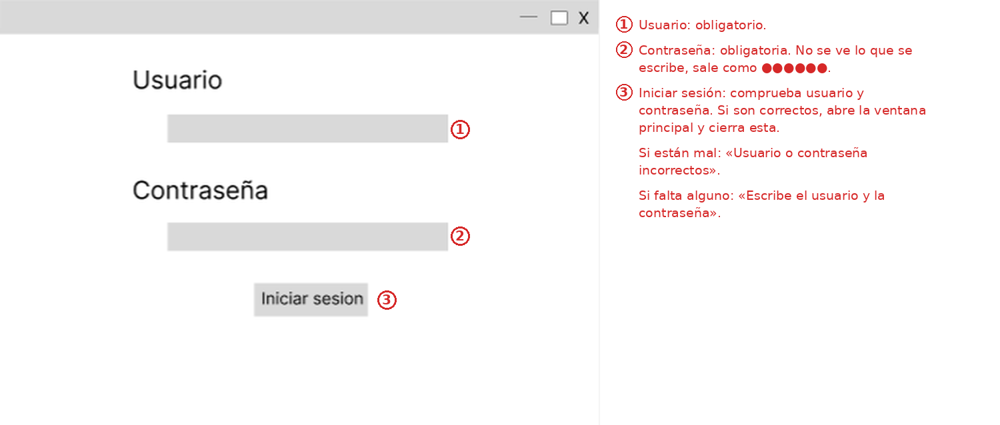
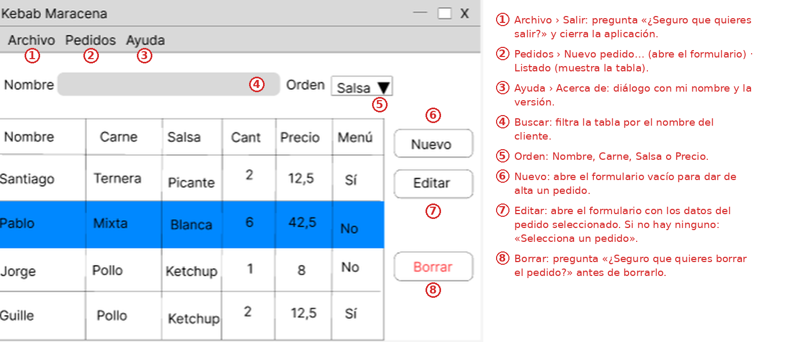
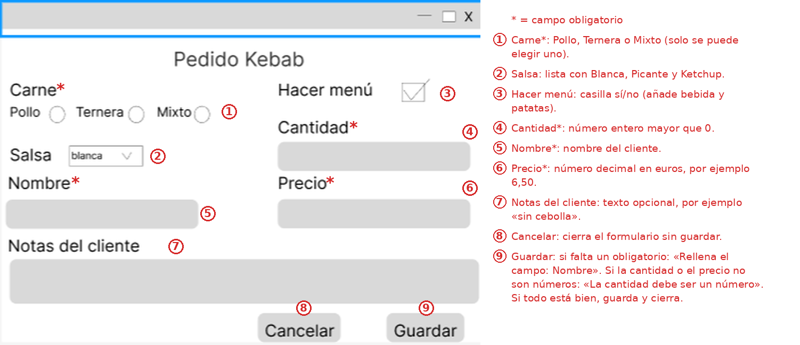

# Ficha de mi aplicación · Hito 0

- **Alumno/a:** Santiago Anas Hidalgo Taoufiki
- **Temática:** kebab (Kebab Maracena)
- **Qué gestiona:** pedidos

## Campos

| # | Campo | Tipo de dato | Componente | Ejemplo de valor / opciones |
|---|-------|--------------|------------|-----------------------------|
| 1 | Nombre | texto | campo de texto | Santiago |
| 2 | Notas del cliente | texto | campo de texto | sin cebolla |
| 3 | Cantidad | entero | campo de texto | 2 |
| 4 | Precio | decimal | campo de texto | 12,50 |
| 5 | Salsa | lista | lista desplegable | Blanca / Picante / Ketchup |
| 6 | Carne | opción | botones de opción | Pollo / Ternera / Mixto |
| 7 | Hacer menú | sí/no | casilla | sí |

Obligatorios: Nombre, Cantidad, Precio y Carne.

## Pantallas

| Pantalla | Foto |
|----------|------|
| Inicio de sesión | `bocetos/1_inicio_sesion.png` |
| Ventana principal | `bocetos/2_ventana_principal.png` |
| Formulario de alta | `bocetos/3_formulario.png` |

### Ventana principal

- **Menús y sus opciones:**
  - Archivo: Salir
  - Pedidos: Nuevo pedido…, Listado
  - Ayuda: Acerca de…
- **Columnas de la tabla:** Nombre, Carne, Salsa, Cantidad, Precio, Menú
- **Buscar y ordenar:** buscador por nombre del cliente y lista «Orden» (Nombre, Carne,Cantidad, Salsa o Precio).

### Qué hace cada botón

- Inicio de sesión › **Iniciar sesión**: comprueba el usuario y la contraseña y, si son correctos, abre la ventana principal y cierra la de inicio.
- Ventana principal › **Nuevo**: abre el formulario de alta vacío. **Editar**: abre el formulario con el pedido seleccionado. **Borrar**: pide confirmación y borra el pedido seleccionado.
- Ventana principal › **Archivo › Salir**: pide confirmación y cierra la aplicación. **Ayuda › Acerca de**: muestra un diálogo con mi nombre y la versión.
- Formulario › **Guardar**: comprueba los campos y guarda el pedido. **Cancelar**: cierra sin guardar.

### Mensajes

- Si el usuario o la contraseña están mal: «Usuario o contraseña incorrectos.»
- Si falta un campo obligatorio en el formulario: «Rellena el campo: Nombre.»
- Si la cantidad o el precio no son números: «La cantidad debe ser un número.»
- Si se pulsa Editar o Borrar sin seleccionar un pedido: «Selecciona un pedido.»
- Al borrar: «¿Seguro que quieres borrar el pedido?»
- Al salir: «¿Seguro que quieres salir?»
- Al cerrar sesion: «¿Seguro que quieres cerrar sesion?»

## Bocetos

